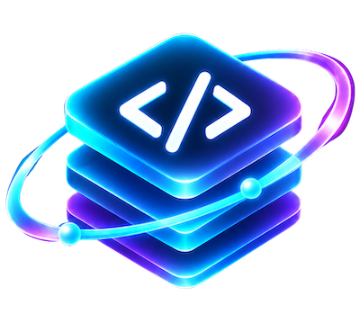

<p align="center">
  
</p>

<h1 align="center">Codebase Intelligence Explorer</h1>

<p align="center">
  <strong>Read-only code intelligence for TypeScript/JavaScript, PHP, and Python: a symbol-level knowledge graph, Git impact analysis, optional multi-provider AI, semantic search, and 2D/3D project exploration.</strong>
</p>

https://github.com/user-attachments/assets/829e9909-0953-4df4-bc12-10c14cf7dcc6

<p align="center">
  <a href="https://github.com/developbat/codebase-intelligence-explorer/actions/workflows/ci.yml"></a>
  <a href="https://www.typescriptlang.org/"></a>
  <a href="https://react.dev/"></a>
  <a href="https://nodejs.org/"></a>
  <a href="https://vitejs.dev/"></a>
  <a href="https://threejs.org/"></a>
  <a href="LICENSE"></a>
</p>

<p align="center">
  <a href="#2-quick-start">Quick start</a> ·
  <a href="#1-what-is-in-the-product">Features</a> ·
  <a href="#4-architecture">Architecture</a> ·
  <a href="#5-api">API</a> ·
  <a href="#9-tests">Tests</a>
</p>

> **Local-first and read-only by design.** Code is never modified, executed, or uploaded unless you explicitly configure an AI provider and request an analysis.

The UI is **English by default** and ships with Turkish, German, French, Spanish, Portuguese, Russian, Chinese, and Japanese. AI answers follow the selected UI language.

---

## 1. What is in the product?

### Static analysis engine

- **Read-only scanning:** source files are read; the analysis engine has no write, delete, move, or execute path.
- **TypeScript Compiler API:** real AST, symbols, types, imports, and call resolution for TypeScript and JavaScript.
- **PHP and Python parser layer:** Lezer-based parsing for classes, interfaces, traits, enums, functions, methods, imports, calls, and framework routes without requiring a PHP or Python runtime.
- **File-level language coverage:** Go, Rust, Java, Kotlin, C#, C/C++, Ruby, Swift, Scala, shell, Lua, R, Dart, Elixir, Erlang, Clojure/F#, SQL, Vue, Svelte, Astro, HTML/CSS, GraphQL, and Protobuf files appear in the file map and Git impact views. Their symbols are not parsed yet.
- **Symbol extraction:** functions, methods, classes, interfaces, type aliases, enums, arrow functions, nested functions, and CommonJS exports.
- **Knowledge graph:** files, folders, classes, functions, routes, database objects, events, packages, and their relationships.
- **Evidence and certainty:** every relationship carries source evidence and is marked `confirmed`, `inferred`, or `unresolved`.
- **Low-noise unresolved handling:** JS/TS builtins, TypeScript utility types, external package declarations, and local runtime values such as state setters do not create false unresolved nodes. PHP/Python resolution is syntax-based, so unresolved-node noise is suppressed there.
- **Call-site inspection:** a genuine unresolved target lists the source locations that produced it, shows a surrounding preview, and can jump to the caller.
- **Project profile without AI:** detects the stack, file/symbol/function/route counts, likely entry points, largest modules, and sample routes directly from the scan.

### Framework and architecture adapters (MVP 2)

- **Routes**
  - Express / Fastify / Koa / Hono style `app.get("/path", handler)`
  - NestJS `@Controller`, `@Get`, `@Post`, `@Put`, `@Patch`, `@Delete`, `@All`
  - Next.js Pages API, App Router `route.ts`, and `page.tsx` file-system routes
  - Laravel `Route::get(...)` and custom router `$router->get(...)` registrations
  - Flask `@app.route(...)`, FastAPI `@app.get(...)` / `@router.post(...)`
- **Databases**
  - Prisma `schema.prisma` models, `@@map`, and model relations
  - TypeORM `@Entity` and Sequelize `@Table`
  - Prisma-style client calls (`prisma.order.findMany()`)
  - Raw SQL reads/writes (`SELECT`, `INSERT`, `UPDATE`, `DELETE`)
- **Events**
  - `emit` / `publish` and `on` / `subscribe` style calls
  - NestJS `@OnEvent` and `@EventPattern`
- **Architecture view:** routes → controllers → services, database access, model relations, and events.
- **Framework detection:** Next.js, NestJS, Express, Fastify, Koa, Hono, React, Vue, Svelte, Prisma, TypeORM, Sequelize, Drizzle, Vitest, Jest, Laravel, Symfony, WordPress, CodeIgniter, Flask, FastAPI, Django, SQLAlchemy, Celery, and Pydantic. Manifest and marker-file heuristics also recognize Laravel, Symfony, WordPress, Django, and Python web layouts without a `.json` manifest.

### Git change intelligence

- Branch, HEAD, subject, dirty state captured at analysis time.
- **Last commit and recent history:** the Changes view always shows the current branch, shortened HEAD, last commit subject/author/date, and the most recent commits—even when the working tree is clean.
- **Commit graph:** a Git-style commit tree with branch/merge lanes, paginated 20 commits at a time. **Load older commits** walks backwards through history without loading everything at once.
- **Commit detail:** click a commit to inspect its metadata, file/line totals, changed files, per-file diff, and impact on the current analyzed graph.
- **Changed-file tree:** commit details rebuild the project folder hierarchy for that commit, with added/modified/deleted/renamed markers.
- **Show on map:** highlight all changed files from a commit, or a single file, directly on the 2D map. Changed nodes show an accent badge until the highlight is cleared.
- Changes since analysis: working tree, commits since the saved HEAD, and only files whose content really changed.
- Unified diff viewer, including synthetic diffs for untracked files.
- Structural diff: added, removed, and changed symbols and edge counts per file.
- Impact analysis: direct/transitive callers, importers, affected routes, and related tests.
- Change graph and changed-file strip.
- **Read-only Git usage:** only `status`, `diff`, `log`, `show`, `rev-parse`, and `rev-list`. No checkout, commit, reset, or write command.

### Optional AI layer (MVP 3)

- **Providers:** OpenAI, Anthropic Claude, DeepSeek, OpenRouter, Google Gemini, NVIDIA NIM, and any custom OpenAI-compatible base URL.
- **Model settings:** API key, base URL, model, test connection, fetch model list, default provider/model.
- **AI symbol analysis:** purpose, business steps, inputs, outputs, side effects, risks, uncertainties, and evidence.
- **AI scope summaries:** file, folder, and package responsibilities/dependencies.
- **AI project summary:** plain-language architecture narrative, key flows, entry points, and architectural risks.
- **AI business flows:** discovers end-to-end flows by following routes, calls, database access, and events.
- **AI change review:** severity, category, file/line, description, and suggested fix from the real Git diff.
- **AI codebase chat:** graph-guided Q&A with source evidence.
- **AI unresolved-target classification:** builtin, external package, dynamic dispatch, callback, string-based registration, or missed local function.
- **Language-aware answers:** every AI flow uses the selected UI language.
- **Honest boundaries:** AI output is labeled as interpretation, cached by provider/model/source hash/language, and kept visually separate from static facts.
- **Local key handling:** keys are stored in `~/.codebase-intelligence-explorer/ai-settings.json` with `0600` permissions and are never returned to the browser.
- **Token visibility:** AI panels show context size and estimated input tokens.

### Search and scale (MVP 4)

- **Local vector search:** TF-IDF sparse vectors over symbols, files, routes, database objects, and events; cosine similarity ranking. The index is cached per analysis fingerprint.
- **Semantic sidebar matches:** result score, snippet, and direct navigation.
- **File watcher:** starts when the UI opens a project. Changes are debounced, re-analyzed in the background, saved, and announced over SSE. The UI shows a “Reload analysis” banner.
- **Hash-based reuse:** unchanged files and AI caches remain valid after a change.
- **Function clustering:** group functions by file for large call graphs and drill into a file.

### 3D Explorer (MVP 5)

- **Three.js + React Three Fiber** scene, lazy-loaded as a separate chunk.
- Same node/edge identities as 2D, search, Git impact, and the inspector.
- **Four layout algorithms:** Hybrid (default), Hierarchical, Clustered, and Force-directed.
- **Hybrid layout:** the project sits on a central layered platform; top-level modules become architectural platform blocks arranged around it; nested folders become smaller blocks, files become glass cards, and functions become small components attached to their file.
- **Hierarchical layout:** project → module → folder → file → function levels descend in 3D space.
- **Clustered layout:** modules are grouped as architectural blocks with their files arranged flat on each platform.
- **Force-directed layout:** a local 3D force simulation for exploring call and dependency networks (220-node focused subset).
- **Zoom-based LOD:** the scene starts with modules only and reveals folders, files, and functions as you zoom in. Selecting a node also reveals its next layer.
- **Edge semantics:** imports, calls, routes, and data flows keep their certainty styling; selecting a node distinguishes outgoing calls (turquoise), incoming calls (orange), unresolved links (dashed), and dims unrelated nodes.
- **Flow-first labels:** by default only the selected node and its flow neighbors show labels. A **Labels → All labels** toggle reveals every label when you want the full map. The label control stays outside the layout popover so it is never covered.
- **Collapsible layout menu:** the layout selector appears large when 3D opens, then collapses into a compact **Layout: Hybrid** button. Click it to reopen the four layout choices.
- **Right-side navigation pad:** smoothly animated free movement — forward/back along the current view direction, strafe left/right, vertical up/down, zoom in/out, and camera reset. Movement always starts from the current camera position, even after orbiting with the mouse.
- **Interaction-only animation:** a larger, high-contrast light packet travels along selected call edges. There is no ambient flashing or constant scene motion.
- **Technical workspace:** no stars. A subtle perspective grid, translucent module platforms, neon selection outlines, low ambient light, and distance-faded links replace the space background.
- **Consistent palette:** project, module/folder, file, function, route, database, and event colors follow the fixed UI palette; certainty is communicated through line style, not node color.
- **Performance:** full-project graph capped at 1,000 nodes / 3,000 edges; visible layers are filtered by LOD, edges are aggregated to visible ancestors, and the Force layout uses a focused 220-node subset.
- **Stay in 3D:** clicking a node selects it and reveals its next layer without switching to 2D. Use the explicit **Open selected item in 2D** button when you want to leave the 3D scene.
- Orbit, pan, zoom, click-to-inspect.
- Labels show the entity name only; type is conveyed by color, shape, the legend, and the inspector.
- The sidebar button toggles between **3D** and **2D** in place.
- Legend, layered HUD, and inspector integration.

### Project profile, full tree, and guided tour

- **Project profile:** the inspector opens with a non-AI overview: detected stack, counts, likely entry points, largest modules, and sample routes.
- **Full project tree by default:** every folder branch is expanded when a project opens. Expand-all and collapse-all buttons are always available.
- **Full-tree 2D view:** the Files view shows the complete folder/file hierarchy in one graph instead of only direct children. The toolbar toggles between **Full tree** and **Direct children**.
- **Up navigation:** in 2D, a back/up control in the topbar and toolbar walks from a file → its folder → parent folder → project universe. Breadcrumb parent links remain clickable.
- **Inspector back stack:** clicking a member or relationship inside the right inspector pushes the previous selection; the **Back** button in the inspector header returns to that exact earlier list/detail, including multi-level drill-down.
- **Guided tour:** the help button in the topbar starts a short tour through opening a project, view tabs, the tree, the graph, the inspector, Git changes, AI setup, and 3D.
- **Guided showcase / promo mode:** the **Demo** button runs an automated 75–90 second tour of the current project with English captions: project profile, tree, call graph, architecture, Git history, commit detail, map highlighting, 3D layouts, and saved-project switching. Pause, skip, exit, and replay controls are included. Screen recording is started externally.

### Project selection

- **Always-visible project switcher:** the active project sits at the top of the sidebar. Open the dropdown to filter and switch between saved analyses without scrolling through the project tree.
- **Home screen saved projects:** when no project is open, the home screen lists saved analyses as icon cards with file/symbol counts and delete actions, so returning to a previous project does not require browsing again.
- **Saved-analysis memory:** each project keeps its own cached analysis, keyed by the project root path. Switching opens that saved graph instantly; it does **not** trigger a new analysis. New Project always analyzes, and Rescan refreshes the current project.
- **Project icons:** the app looks for local favicons/logos (`favicon`, `icon`, `logo`, `apple-touch-icon`) in common locations. Projects without an image fall back to a language-colored initial.
- Manual full path.
- **Browse…** folder browser with:
  - Home, Desktop, Documents, Downloads, Volumes, Root shortcuts
  - Breadcrumbs, parent navigation, hidden-folder toggle
  - Folder filter and manual path entry
  - Local filesystem directory listing only; no file content is read by the browser API
- App icon: `web/public/cbe.png`. If a local `docs/cbe.png` exists, the dev server syncs it automatically and triggers a full reload.

### Internationalization

Included locales:

| Code | Language |
|---|---|
| `en` | English |
| `tr` | Turkish |
| `de` | German |
| `fr` | French |
| `es` | Spanish |
| `pt` | Portuguese |
| `ru` | Russian |
| `zh` | Simplified Chinese |
| `ja` | Japanese |

- Locale dictionaries live in `web/src/i18n/locales/`.
- Missing keys fall back to English; new keys/languages can be added incrementally.
- Date/number formatting uses the selected locale.
- The selected language is persisted.
- AI prompts explicitly instruct the provider to answer in the selected language while preserving identifiers, paths, JSON keys, and enum values.

---

## 2. Quick start

### Requirements

- **Node.js 18+** and npm
- **Git** (optional, for the Changes / review workflow)
- A modern Chromium, Firefox, or Safari browser
- No database server is required

### Install and run

```bash
git clone https://github.com/developbat/codebase-intelligence-explorer.git
cd codebase-intelligence-explorer
npm install
npm run dev
```

Open **http://localhost:5173**.

1. Click **Open Project** (or **Browse…**) and choose a TypeScript/JavaScript, PHP, or Python project folder.
2. Or click **Open sample project** to explore `fixtures/sample-app`.
3. Use the **active project card** at the top of the sidebar to switch between saved analyses. Switching opens the cached graph instantly; it does not rescan.
4. Use **Universe**, **Files**, **Calls**, **Architecture**, **Changes**, and **3D** from the sidebar.
5. All tree branches are expanded by default; use the chevrons to expand or collapse everything. The help button starts a guided tour.
6. Select any node to inspect it and highlight its direct connections. In 2D, **Up** walks from file → folder → project. In 3D, selection stays in 3D; use **Open selected item in 2D** for an explicit handoff.
7. Open **AI setup** to connect an optional provider.

### Production build

```bash
npm run build
npm start
```

The production UI and API are served at **http://127.0.0.1:4317**.

### CLI

```bash
npm run analyze -- /absolute/path/to/project
npm run analyze -- fixtures/sample-app
```

---

## 3. Commands

| Command | Purpose |
|---|---|
| `npm run dev` | Vite UI + analysis API (5173 / 4317) |
| `npm run dev:server` | API only |
| `npm run build` | Typecheck + production UI build |
| `npm start` | Production UI + API |
| `npm test` | Static analysis, MVP 2, Git, and AI service tests |
| `npm run typecheck` | TypeScript checks |
| `npm run analyze -- <path>` | Analyze from the CLI |

---

## 4. Architecture

```text
web/
  public/cbe.png                 App icon / favicon / manifest icon
  src/
    App.tsx                      Shell, views, dialogs, SSE updates
    api.ts                       Typed local API client
    i18n/                        Provider + en/tr/de/fr/es/pt/ru/zh/ja dictionaries
    lib/
      viewGraph.ts               Universe / files / calls / architecture / changes / 3D views
      threeGraph.ts              Full-project 3D graph (layered LOD source)
      threeLayout.ts             Hybrid / hierarchical / clustered / force 3D layouts
      layout.ts                  ELK layered layout + radial universe layout
      ai.ts                      Active provider selection
      constants.ts               Colors and labels
    components/
      Sidebar.tsx                Tree, search, semantic results
      ProjectSwitcher.tsx        Always-visible saved-project switcher
      ProjectIcon.tsx            Local project icon with fallback
      GraphCanvas.tsx            React Flow 2D map, fit, focus, edge evidence
      EntityNode.tsx             Custom graph node rendering
      Universe3D.tsx             React Three Fiber 3D explorer
      Inspector.tsx              Entity details, source, Git diff, AI panels
      ProjectProfile.tsx         Non-AI stack/counts/entry-point inference
      GitSummary.tsx             Branch, HEAD, last commit, recent history
      GitHistory.tsx             Paginated Git commit graph
      GitCommitDialog.tsx        Commit file tree, diff, and graph impact
      TourButton.tsx             driver.js guided tour
      ShowcaseDemo.tsx           Automated promo tour with captions and controls
      SourcePreview.tsx          Read-only highlighted source
      GitDiffView.tsx            Unified diff viewer
      FolderBrowserDialog.tsx    Filesystem folder picker
      AiSettingsDialog.tsx       Provider/model/API key setup
      AiSymbolPanel.tsx          Function/class AI analysis
      AiScopePanel.tsx           File/folder/package AI summary
      AiProjectSummary.tsx       Architecture narrative
      AiFlowsDialog.tsx          Business-flow discovery
      AiReviewDialog.tsx         AI code review
      AiUnresolvedInvestigation.tsx
      AiChatDrawer.tsx           Project Q&A
server/src/
  scanner.ts                     Read-only scan, ignore rules, secret filtering
  analyzer.ts                    AST, symbols, calls, routes, databases, events
  languages.ts                   PHP/Python Lezer parsing, imports, calls, routes
  icons.ts                       Safe local favicon/logo discovery
  git.ts                         Read-only Git status/log/diff
  changes.ts                     Structural diff + impact analysis
  search.ts                      Local TF-IDF vector index and ranking
  watcher.ts                     Chokidar watcher + SSE refresh stream
  fsbrowse.ts                    Directory-only browser API
  store.ts                       JSON analysis/recent cache
  ai/
    settings.ts                  Provider/model/key persistence (0600)
    providers.ts                 OpenAI-compatible, Anthropic, Gemini adapters
    service.ts                   Symbol/scope/project/flow/review/chat/unresolved AI
  index.ts                       Local HTTP API
shared/
  types.ts                       Graph, Git, change, search, folder contracts
  ai.ts                          Provider catalog, AI result contracts, languages
fixtures/sample-app/             End-to-end sample order project
```

### Analysis flow

1. **Scanner** builds a file tree and filters build output, dependencies, caches, lockfiles, and secret files.
2. **TypeScript program** parses TypeScript/JavaScript with project `tsconfig` support; the Lezer layer parses `.php` and `.py` files.
3. **Symbol extraction** records names, ranges, signatures, parameters, return types, exports, and source hashes.
4. **Semantic resolution** links calls to real declarations through the TypeScript checker; PHP/Python links are import- and name-based and marked `inferred`.
5. **Framework adapters** add routes, controllers, database objects, relations, queries, and events.
6. **Knowledge graph** stores nodes/edges with evidence and certainty.
7. **Views** consume the same graph identities: 2D, 3D, inspector, Git impact, search, AI context.

---

## 5. API

| Endpoint | Purpose |
|---|---|
| `POST /api/analyze` | Analyze `{ "path": "..." }` |
| `GET /api/recent` | Recent analyses |
| `GET /api/projects/:id` | Stored analysis |
| `GET /api/projects/:id/icon` | Local project favicon/logo, if present |
| `POST /api/projects/:id/rescan` | Re-analyze |
| `DELETE /api/projects/:id` | Remove cached analysis |
| `GET /api/projects/:id/source` | Read-only source range |
| `POST /api/projects/:id/search` | Local vector search |
| `GET /api/projects/:id/events` | SSE watcher stream |
| `GET /api/projects/:id/git` | Branch, HEAD, changed files, commits |
| `GET /api/projects/:id/git/commits` | Paginated commit graph (`limit`, `skip`) |
| `GET /api/projects/:id/git/commits/:hash` | Commit detail: files, stats, graph impact |
| `GET /api/projects/:id/git/commits/:hash/diff` | File diff inside a commit |
| `GET /api/projects/:id/git/diff` | Unified diff against a base |
| `POST /api/projects/:id/changes` | Re-analyze + structural diff + impact |
| `GET /api/fs/list` | Directory-only folder browser |
| `GET/PUT /api/ai/settings` | Public AI settings / update config |
| `POST /api/ai/test` | Test provider connection |
| `GET /api/ai/models` | Fetch provider model list |
| `POST /api/projects/:id/ai/symbol` | Explain a real symbol |
| `POST /api/projects/:id/ai/scope` | File/folder/package summary |
| `POST /api/projects/:id/ai/summary` | Project architecture narrative |
| `POST /api/projects/:id/ai/flows` | Discover business flows |
| `POST /api/projects/:id/ai/review` | Review pending changes |
| `POST /api/projects/:id/ai/unresolved` | Classify an unresolved target |
| `POST /api/projects/:id/ai/chat` | Graph-grounded Q&A |
| `GET /api/health` | Health check |

All endpoints bind to `127.0.0.1`.

---

## 6. Git workflow

1. Analyze a project. The analysis stores the current Git HEAD and file hashes.
2. Open **Changes** to see changed files since that snapshot.
3. Click **Analyze changes** to:
   - re-analyze the current working tree
   - compare old/new symbols and edges
   - compute direct/transitive impact
   - find affected routes and tests
4. Inspect a changed file in the Inspector: Git diff + structural changes.
5. Click **AI review** to review the actual diff.
6. The watcher can also refresh the stored analysis in the background; use the banner to reload the UI.

Git is strictly read-only.

---

## 7. AI setup

1. Open the sparkles / **AI setup** control.
2. Select a provider.
3. Enter API key, base URL, and model.
4. Use **Fetch models** and **Test connection** as needed.
5. Check **Use this provider and model as default**.

Provider defaults and model suggestions are in `shared/ai.ts`. Custom OpenAI-compatible endpoints (for example a local Ollama server) are supported.

### Privacy

- Keys are stored locally with `0600` permissions and masked in API responses.
- Source excerpts are sent only for the specific AI request you trigger.
- AI panels show the context size/tokens and the files sent.
- AI output is always labeled as interpretation, not static proof.

### Language handling

Every AI request carries the selected UI locale. The server appends an explicit instruction such as “Write every human-readable string value in German” while keeping code identifiers, file paths, JSON keys, and enum values unchanged. The language is part of the cache key, so switching languages does not reuse an answer in the old language.

---

## 8. Security model

- Read-only project access.
- `.env`, keys, certificates, and secret files excluded before reading.
- Source preview cannot escape the project root; symlinks re-validated with `realpath`.
- Git uses argument arrays, never a shell.
- Folder browser lists directories only.
- AI keys never returned to the browser.
- No provider is contacted unless configured and explicitly requested.
- No code execution, shell execution, or write path in the analyzer.

---

## 9. Tests

```bash
npm test
```

Current coverage (6 tests):

1. Fixture call graph and evidence.
2. CommonJS `require()` / `exports.x`.
3. Secret and `node_modules` exclusion.
4. MVP 2 adapters: NestJS/Express routes, Prisma relations, ORM queries, events.
5. Git status, diff, commits since analysis, commit graph/detail/diff, structural diff, impact.
6. AI service: real source prompt, structured result, cache, language instruction, grounded chat.

Manual browser verification covers folder browsing, all views, PHP/Python projects, the guided tour, the project profile, Git last-commit history and commit detail, 3D hybrid/hierarchical/clustered/force layouts, 3D LOD selection, 2D up navigation, semantic search, Git changes, AI panels, and language switching.

---

## 10. Current status

| Area | Status |
|---|---|
| MVP 1 — static map, symbols, call graph | ✅ |
| MVP 2 — routes, ORM, DB, events, architecture | ✅ |
| MVP 3 — AI providers, symbol/scope/project/flow/review/chat, languages | ✅ core |
| MVP 4 — local vector search, watcher, clustering, hash reuse | ✅ core |
| MVP 5 — 3D project explorer | ✅ core |
| 3D hybrid / hierarchical / clustered / force layouts | ✅ |
| 3D zoom LOD + aggregated edges + interaction-only flow animation | ✅ |
| 3D stays active while inspecting; explicit 2D handoff | ✅ |
| 3D navigation pad + flow-only labels toggle | ✅ |
| Smooth 3D free movement + collapsible layout menu | ✅ |
| 2D up / parent navigation | ✅ |
| Inspector back stack for previous list/detail | ✅ |
| PHP / Python symbol, import, call, and route support | ✅ core |
| Git last commit + recent history in Changes | ✅ |
| Git commit graph, pagination, commit detail, diffs | ✅ |
| Highlight commit-changed files on the 2D map | ✅ |
| Full-tree Files view and expanded tree by default | ✅ |
| Non-AI project profile | ✅ |
| Guided tour | ✅ |
| Automated 75–90s promo showcase with English captions | ✅ |
| Always-visible project switcher + saved-analysis memory | ✅ |
| Project icon discovery with language fallback | ✅ |
| File-level map for many additional languages | ✅ files only |
| Symbol-level support for every language | ⏳ TS/JS, PHP, Python today |
| Folder browser | ✅ |
| English UI + 9 languages | ✅ core translations with English fallback |
| Desktop packaging | ⏳ local web app |
| SQLite store | ⏳ JSON cache |
| OS keychain | ⏳ 0600 local file |

### Remaining / future work

- **Symbol-level parsers for more languages:** Go, Rust, Java, Kotlin, C#, C/C++, Ruby, Swift, and others currently appear as file-level nodes only. TS/JS, PHP, and Python have symbol/call/route extraction today.
- **More PHP/Python framework adapters:** Laravel routes and Flask/FastAPI decorators are covered; deeper Django, Symfony, and WordPress route/ORM conventions are next.
- **Cross-language call resolution:** calls between different runtimes (for example PHP → JavaScript or Python → SQL) are not resolved as typed symbols.
- **Deeper PHP/Python precision:** classes, functions, methods, imports, calls, and common framework routes are detected, but resolution is syntax-based rather than type-checked. Dynamic dispatch, dependency-injection bindings, and generated code may remain unresolved or inferred.
- **Neural embeddings** and provider-backed vector search (the current index is local TF-IDF, not a neural embedding model).
- **True streaming** AI responses, cancellation, and precise provider-specific cost estimates (tokens are shown today).
- **Fully incremental parser**; the watcher triggers a safe full re-analysis, while file hashes and AI caches prevent unnecessary AI work.
- **Full translations** for every string in every new language (menus/core screens are translated; missing keys fall back to English).
- **InstancedMesh batching for very large 3D scenes:** the current renderer uses LOD, edge aggregation, and per-node meshes for accurate hover/selection; instancing is the next step beyond 1,000 nodes.
- **3D streaming for very large projects:** current LOD reveals deeper layers by zoom and selection, but the full 3D graph is still capped at 1,000 nodes / 3,000 edges.
- **Desktop shell** (Tauri/Electron) and OS keychain integration.
- **SQLite migration** for very large projects.
- **More language adapters** (Go, Java, C#, Rust, etc.).
- **Benchmarks** on very large repositories and accessibility polish.

---

## License

Released under the [MIT License](LICENSE).

<p align="center">
  Built for developers who want to understand a codebase before touching it.
</p>
